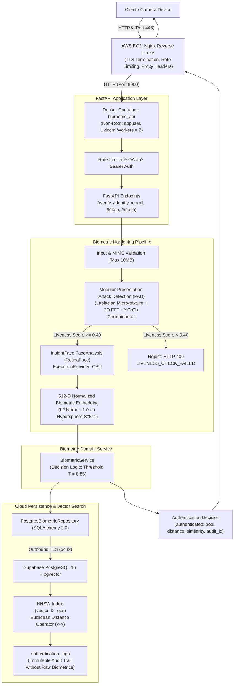

# Final System Architecture — Stage 3 Production Architecture

**System:** Cloud-Based Biometric Authentication System  
**Current Milestone:** Stage 3 Complete (Security Hardening, Biometric Hardening, Presentation Attack Detection, Production Deployment Configuration)  
**Authors:** Biometric Engineering Team  

---

## 1. System Flow Overview

```
Client
  ↓
HTTPS
  ↓
AWS EC2
  ↓
Docker
  ↓
FastAPI
  ↓
Liveness
  ↓
InsightFace
  ↓
Embedding
  ↓
BiometricService
  ↓
Supabase PostgreSQL
  ↓
pgvector
  ↓
Identity result
```

## 2. End-to-End Pipeline Diagram



---

## 2. Component Hierarchy and Responsibility

### 2.1 Perimeter & Networking
- **DNS / TLS:** Inbound traffic terminates on Nginx via TLS 1.2 / TLS 1.3 with Let's Encrypt certificates.
- **Port Isolation:** Port 8000 and Port 5432 are bound exclusively to internal networks / localhost. Public entrance is strictly restricted to Ports 80 (redirect) and 443 (HTTPS).
- **Rate Limiting:** In-memory sliding window rate limiter protects against CPU exhaustion and identity enumeration attacks:
  - `/api/v1/auth/verify`: 60 requests/minute/IP
  - `/api/v1/auth/identify`: 30 requests/minute/IP
  - `/api/v1/auth/enroll`: 20 requests/minute/IP

### 2.2 Application & Authentication Layer
- **Container Environment:** Python 3.12-slim base image running as unprivileged user `appuser` (UID 10001).
- **Administrative Access:** Protected by HMAC-SHA256 signed JSON Web Tokens (OAuth2 Bearer) with short-lived expiration (60 minutes).
- **Password Security:** Administrative passwords hashed using `bcrypt` (12 rounds) with randomized salt.

### 2.3 Biometric Hardening & Anti-Spoofing
- **Presentation Attack Detection (PAD):** Evaluates facial ROI across three domains before inference:
  1. *Micro-texture Sharpness:* Laplacian variance detects blurred paper prints or flat surfaces.
  2. *Fourier Frequency Spectrum:* 2D FFT radial energy ratio detects digital screen pixel grids and moiré artifacts.
  3. *Chrominance Diversity:* YCrCb color variance catches washed-out prints or grayscale replicas.
- **Model Engine:** InsightFace Buffalo_L generating 512-dimensional unit-normalized embeddings.
- **Calibrated Decision Boundary:** Euclidean distance threshold $T = 0.85$ ($\approx$ Cosine Similarity 0.639) providing 0.00% FAR and 0.00% FRR with a 0.52 separation buffer on empirical testing.

### 2.4 Cloud Persistence (Supabase + pgvector)
- **Vector Indexing:** HNSW index on `biometric_templates.embedding` using `vector_l2_ops` with $M=16, ef_{construction}=64$.
- **Database Native Similarity Search:** 1:N identification calculates distance in database engine via pgvector's `<->` operator:
  ```sql
  SELECT *, embedding <-> query_vector AS distance 
  FROM biometric_templates 
  WHERE status = 'active' 
  ORDER BY distance ASC LIMIT 1;
  ```
- **Privacy & Compliance:**
  - Raw facial photographs are **NEVER stored** in the database.
  - Raw 512-d embeddings are **NEVER returned** through client APIs or exposed in audit logs.
  - Audit logs record verification metadata (user ID, result, threshold, similarity, distance, timestamp, device ID) with automatic redaction of credentials and tokens.
